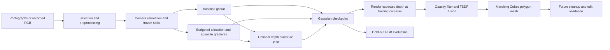

# Project definition and implementation plan through Week 10

Prepared 9 November 2026 to close gaps in the schedule ending 8 November. This is a retrospective consolidation plus newly executed work, not evidence that deliverables existed on their original due dates. The user supplied the project title below and confirmed that no supervisor presentation has occurred yet. Supervisor approval remains outstanding.

## Objectives and scope

User-confirmed project title: Improving 3D Gaussian Splatting for efficient and geometrically consistent 3D reconstruction, followed by conversion into editable polygon meshes.

Input: static overlapping photographs with camera intrinsics/extrinsics estimated by COLMAP, or a self-collected RealSense sequence with documented RGB-D calibration. Output: optimized Gaussian checkpoint, held-out renders, polygon mesh, configuration/provenance and failure report. The final scheduled outcome also requires an editable asset; Week 10 requires an initial raw mesh, while cleanup and editing are Week 11 tasks.

Questions: (1) Can budgeted evidence-based allocation reduce count while maintaining rendering quality? (2) Does an image-edge-aware depth curvature prior improve surface proxies without excessive rendering loss? (3) Can training-camera depth rendered from the optimized model yield an inspectable polygon mesh?

The contribution is an evaluated integration and empirical study. Budgeting, absolute gradients, long-axis splitting, depth smoothness and TSDF fusion each have prior work. CCD-GS remains a negative mechanism experiment, not the validated main method.

## Architecture



Source sensor depth can supervise a separate controlled training experiment; it is not used as the mesh extractor's input. No held-out camera is fused into the mesh. The mesh coordinates inherit the training parser's normalization; metric scale requires separate validation.

## Evaluation and acceptance checklist

| Dimension | Measure | Decision |
|---|---|---|
| Render quality | Float PSNR, SSIM, LPIPS; same held-out image identities | Against matching no-prior arm, exploratory surface guardrails: PSNR loss <=0.2 dB, SSIM loss <=0.005, LPIPS increase <=0.01 |
| Efficiency | Final/peak Gaussians, peak allocated tensor memory, checkpoint bytes, wall/training/extraction seconds | Report measured tradeoffs; workstation time is not a controlled speedup claim |
| Surface representation | Nonzero finite vertices/faces, connected components, boundary/nonmanifold edges, scale and missing regions | These measure usability/topology, not physical accuracy |
| Surface consistency | Fixed-view mesh depth versus Gaussian expected depth and curvature summaries | Agreement with own model is a proxy, not independent validation |
| Absolute geometry | Distance/normal comparison only if reference mesh or independently validated depth exists | Room does not currently support an absolute accuracy claim |
| Editability (Week 11) | Import, select vertices/faces, perform a simple edit and save/reopen in a design tool | Not satisfied merely by a PLY export |
| Reproducibility | Source/config hashes, matching initial/camera sequence hashes, finite checkpoint, split identities | Required for every compared training arm |

## Dataset inventory and capture plan

| Scene group | Role and evidence | Constraints |
|---|---|---|
| Mip-NeRF 360 Room | Primary four-arm reduction x surface-prior ablation; 272 train /39 held-out, factor-two images | Previously exposed development views; no reference surface |
| Counter, Kitchen, Bonsai | Existing B00/A04 three-seed benchmark; A05-Abs on first two, two seeds | Indoor scope; do not infer outdoor generalization |
| Personal room 20261030_134523 | 477 selected views, 417 train /60 held-out; baseline and calibration diagnostics | Geometry/calibration gate remains open; no claim that all room surfaces recovered |
| Personal courtyard | Existing 3/30 FPS reconstructions, shared 88-target comparisons | Moving people and revisit drift; static model limitations |

Public preprocessing and training sources: `examples/datasets/colmap.py`, `scripts/research_campaign.py`, `scripts/research_a05.py`. Personal pipeline and source identities: `docs/ROOM_STEPS_1_TO_6_PROGRESS_20261103.md`, `docs/RESEARCH_PROGRESS_REPORT_20261106.md`. Preserve originals; record frame identities, sampling, intrinsics, pose conventions and rejected views. Existing preprocessing filters and diagnostics are evidence; they do not establish an exhaustive manual blur/duplicate review. Future capture should target a static matte object, overlap across elevations, avoid motion blur/reflections, retain original images and calibration, and reserve a sequence before tuning.

## Technical choices and ablations

Keep baseline gsplat density control as B00. Use the existing A05 absolute-gradient allocation as the reduced arm, frozen at grow_grad2d=0.0008, 700k cap, long-axis split and attributed RGB/edge ranking. Add log-depth curvature with RGB-edge weights, detached alpha support >0.7 and weight 0.01 starting step 3000. It is an explicit smoothness hypothesis and can erase thin detail; it is not SuGaR or 2DGS.

Four Room seed-42 arms use 7,000 updates and matching initialization/camera order: baseline, baseline+prior, reduced, reduced+prior. The two no-prior arms reuse verified archived runs; both prior arms are newly trained. Checkpoint hashes are checked before reuse and initialization/camera-sequence hashes must match. Current loader workers are zero to avoid Windows cache duplication; the camera sequence is checked explicitly. The prior is disabled by default, preserving the no-prior loss/render path. This is not a simultaneous four-run timing benchmark. Fix the protocol before results; no post-hoc selection of a better weight. Existing multiscene/seed studies support reduction; this single-scene factorial only probes the new constraint. Keep a negative outcome if the prior fails. Mesh extraction uses identical TSDF settings for all arms: 64 evenly spaced training cameras, quarter-resolution render, alpha >0.7, voxel=0.01*scene_scale, truncation=4 voxels. Record all settings and raw topology.

## Review routine and supervisor material

Each weekly review records: goal, command/config/source hashes, measured results, failure/limitations, next decision and links to artifacts. This routine starts with this consolidation; earlier weekly meetings are not asserted. Supervisor review agenda:

1. Confirm the official title and whether the integration/empirical contribution meets CO4029 expectations.
2. Approve rendering/count plus surface extraction scope; discuss lack of absolute reference geometry.
3. Review reduction gains, failed CCD mechanism and new surface-prior ablation.
4. Agree on a small final asset and criteria for Week 11 editing and Week 12 evaluation.
5. Record feedback and resulting changes in a dated entry; no feedback is currently invented.

## Reproduction

Execution update: the local scalable TSDF failed a known-plane control. Accepted extraction uses a bounded uniform TSDF with the common SfM percentile box enlarged 20% and resolution capped at 192; see the [results and candidate decision](SCHOOL_COMPLETION_RESULTS_20261109.md). Exact camera replay is required to match archived persistent-worker controls. The main candidate retains surface_lambda=0 because the tested 0.01 alternative had mixed topology results.

```powershell
.\scripts\run-school-completion.ps1 -m pytest tests/test_surface.py -q
.\scripts\run-school-completion.ps1 scripts/school_surface_campaign.py --root results/school_surface_smoke_NEW --smoke
.\scripts\run-school-completion.ps1 scripts/school_surface_campaign.py --root results/school_surface_NEW
.\scripts\run-school-completion.ps1 scripts/gaussians_to_mesh.py --checkpoint results/school_surface_NEW/replication/room/reduced_surface/ckpts/final_post_update.pt --data data/room_factor2 --output results/school_mesh_NEW
```

Use fresh output directories. The campaign intentionally rejects existing roots to prevent overwriting evidence. Current execution and outcomes belong in `SCHOOL_COMPLETION_RESULTS_20261109.md` and the experiment log.
