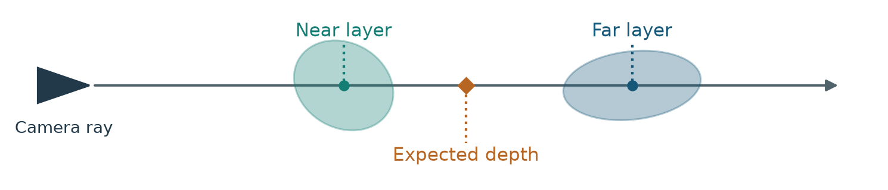
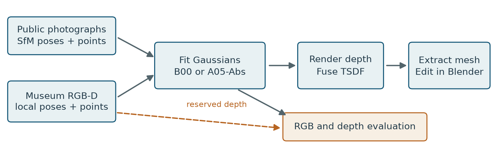
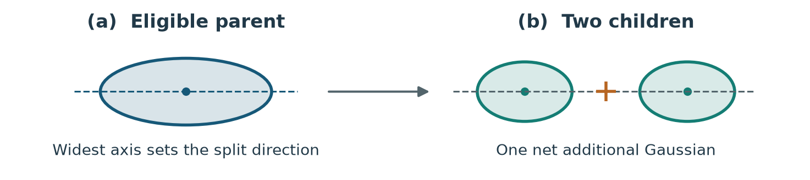
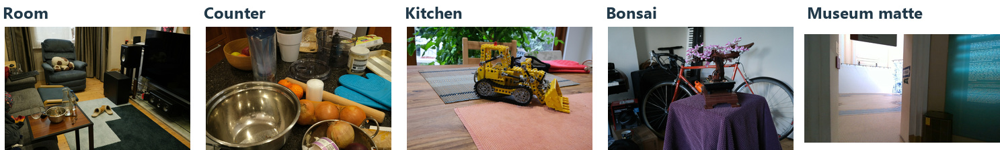
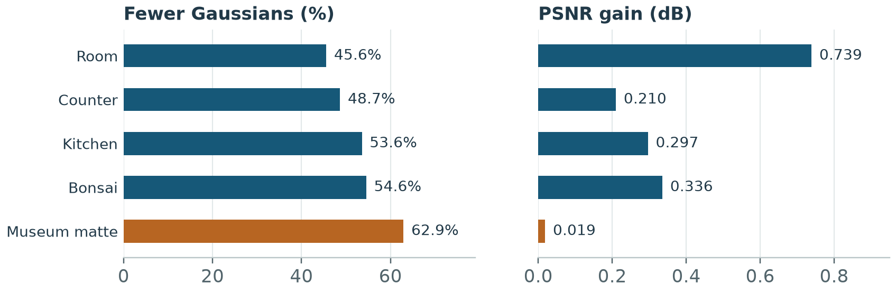
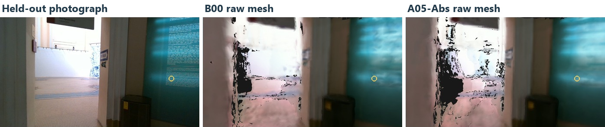
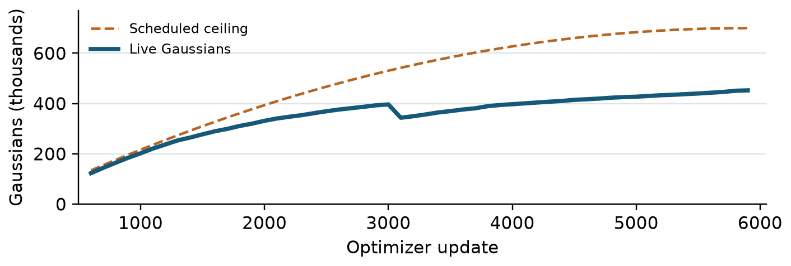
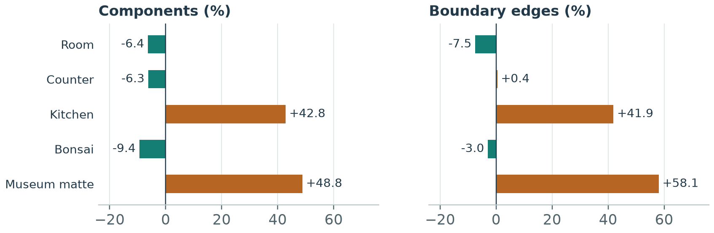
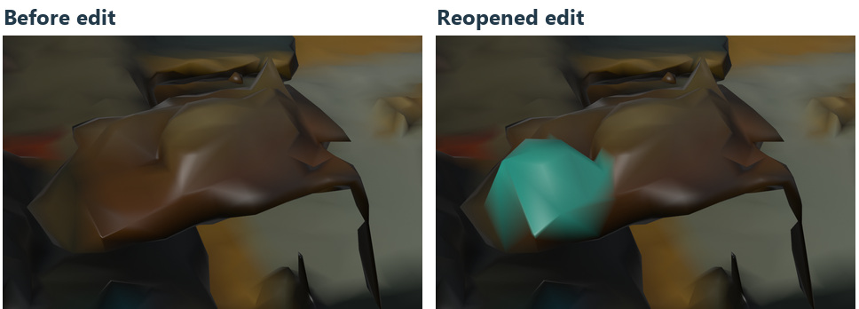

# Improving 3D Gaussian Splatting for efficient and geometrically consistent 3D reconstruction, followed by conversion into editable polygon meshes

**Archived prototype draft.** The revised manuscript starts at [final_report.tex](final_report.tex). The updated PDF and the [reproduction guide](REPRODUCE.md) contain the expanded methodology and the follow-up experiments.

**Nguyen Vu Long (2352696)** · Specialized Project (CO4029) · Lecturer Nguyen Tuan Khoi  
Faculty of Computer Science and Engineering, Ho Chi Minh City University of Technology  
Final report prototype · 19 November 2026

## Abstract

A 3D Gaussian scene can reproduce a photograph while assigning color to several depths along the same ray. This distinction matters when the intended deliverable is a polygon mesh that a designer can edit. This project implements budgeted densification in gsplat, extracts a surface from the optimized models and tests whether a local edit survives a save-and-reopen cycle in Blender. At 7,000 matched training updates, the candidate used 45.57–54.56% fewer Gaussians than the baseline across four indoor Mip-NeRF 360 scenes and raised mean held-out PSNR by 0.210–0.739 dB. On a short RealSense D455 segment, it used 62.94% fewer Gaussians, but its mesh fragmented into more components and its median absolute discrepancy against reserved sensor depth increased from 8.38 to 9.47 cm. A tabletop edit persisted on the cleaned public Room mesh. These results support a more compact representation for the tested scenes and demonstrate local editability. Independent physical surface accuracy remains an open question.

**Keywords** 3D Gaussian Splatting, adaptive densification, RGB-D reconstruction, volumetric fusion, mesh editing

# 1 Introduction

## 1.1 Motivation and problem statement

In the public Room photographs, a coffee table has a broad horizontal top, clutter resting on it and narrow supports below it. A renderer can reproduce the tabletop color even when a reconstructed surface joins the clutter to the top. For an editor selecting and lifting part of that table, the location and connectivity of the triangles matter. The project therefore asks how much Gaussian capacity can be removed at a fixed training budget, and what happens to image quality, surface continuity and editability after extraction.


## 1.2 Objectives and evidence

*Table 1. Objectives and corresponding measurements.*

| Objective | Observable outcome |
|---|---|
| Reduce representation cost | Compare primitive counts, checkpoint sizes and held-out RGB scores under paired camera sampling. |
| Recover a usable surface | Extract raw meshes at common resolution, measure fragmentation, and inspect the same photographed details in both arms. |
| Test geometric consistency | Compare first-hit mesh depth with reserved sensor depth at shared, stable pixels in the personal matte segment. |
| Demonstrate editability | Select a connected surface, displace it, save the project and measure the evaluated geometry after reopening it. |

## 1.3 Scope and contributions

The principal case is a static indoor scene reconstructed from prepared photographs and supplied camera poses. Three further public scenes test whether the count reduction transfers. A personal museum recording adds a local depth-assisted condition. Public Room and the personal museum are different scenes. The contribution comprises the budget and ranking integration, matched training and extraction protocol, sensor-depth checks, and a reproducible mesh edit. Figure 1 follows the tabletop through these representations. Chapters 2 and 3 explain the representation and implementation. Chapter 4 tests each objective, and Chapter 5 states which conclusions the evidence supports.

# 2 Theoretical Background and Related Work

## 2.1 From images to a scene representation

A calibrated camera maps a 3D point to a pixel using its intrinsics and pose. Structure from Motion (SfM) estimates poses and sparse points from feature correspondences across images. Bundle adjustment refines them by minimizing reprojection error [1]. Limited overlap, repeated texture and moving or specular surfaces can make correspondences ambiguous. Sparse tracks give a useful initialization, while polygon connectivity requires an additional surface model. The public experiments start from the camera and point files distributed with the Mip-NeRF 360 scenes [2].

NeRF represents a scene by a continuous function of position and viewing direction. Sampling this function along a ray yields density and color for view synthesis [3]. Kerbl et al. instead optimize explicit anisotropic Gaussians and render their projected footprints [4]. Their representation permits inserting, splitting and pruning individual primitives. The gsplat library provides the differentiable rasterizer and PyTorch interface used in this project [5].

## 2.2 Gaussian representation and rendering

Each Gaussian has a center, a rotation, three positive scales, an opacity and spherical-harmonic color coefficients. Its covariance is $\Sigma=R\,\mathrm{diag}(s_1^2,s_2^2,s_3^2)R^\top$. Projecting this ellipsoid into a camera yields a screen-space footprint. For a depth-ordered set of contributors, the weight of contributor $i$ is $w_i=\alpha_i\prod_{j<i}(1-\alpha_j)$, where $\alpha_i$ includes its footprint at the pixel. With a black background the pixel color is $C=\sum_i w_i c_i$. The expected depth used here is $D=\sum_i w_i z_i/\sum_i w_i$ on supported pixels. Figure 2 illustrates why two layers can give the right color and place this average between the layers.



## 2.3 Density control and surface reconstruction

An image residual can motivate allocating more primitives to a region. Opposing pixel gradients can cancel before a split decision. AbsGS addresses this problem using absolute positional gradient information [6]. Long-Axis Split places children along the parent's longest direction, a mechanism studied by Deng et al. [7]. Here both mechanisms enter a single budgeted policy. Their independent effects require separate controls.

Surface-aligned methods such as SuGaR constrain the Gaussian representation during optimization and use it to recover a mesh [8]. This project preserves the classic renderer across both comparison arms and changes how primitives are allocated. It recovers polygons afterward using a truncated signed distance function (TSDF). Volumetric fusion averages signed-distance observations near a surface and extracts the zero crossing [9]. Here the observations come from Gaussian expected depth. All extracted surfaces therefore inherit uncertainty in the learned depths and the camera poses.

# 3 System Analysis and Design

## 3.1 Input preparation and camera estimation

In Figure 3 the two input routes share a trainer and extractor. Their camera and depth evidence differ. The public route reads factor-two photographs, rescales intrinsics to their actual dimensions and preserves the supplied sparse points and camera poses. Sorting image names and reserving every eighth view yields the same evaluation targets for both methods. The dataset audit checked dimensions, duplicate hashes, finite points and valid rotations. Low texture in a wall patch was insufficient reason to remove its photograph [E1].

The personal route associates RGB and depth messages by source identity and time, projects depth into the color camera with the replay calibration, and retains the association for later checks. In the matte region, fixed-calibration feature tracks support local bundle adjustment with reprojection and camera-depth residuals. Fitting tracks establish local metric scale. Three reserved color images are localized against the fixed map using RGB features. Their depth messages enter evaluation only. The 95 registered cameras include tracking views. The Gaussian experiment uses an explicit subset of 21 fitting and three evaluation views [E2].



## 3.2 Training and allocation

B00 uses the gsplat default density-control strategy. A05-Abs is the project candidate. It integrates the renderer's absolute screen-space positional gradients with budgeted growth, contribution-weighted RGB error, image edges and a deterministic Long-Axis Split. Both methods fit the same RGB objective, $0.8L_1+0.2(1-\mathrm{SSIM})$. The matte experiment adds a confidence-weighted disparity loss at weight 0.01 in both arms. No sensor loss enters the public runs [E2, E3].

At a refinement event, A05-Abs first screens candidates with an absolute-gradient threshold of 0.0008. It ranks eligible parents by gradient, attributed reconstruction error and edge strength with weights 1, 1 and 0.25. Error and edge evidence is discounted when few observations support a parent. Up to four contributing Gaussians per observed pixel receive attribution. The growth schedule limits the number of eligible parents that can split. Replacing one parent by two children increases the live count by one before pruning. A ceiling can remain partly unused when few parents qualify [E3].

<!-- page -->

## 3.3 Allocation, surface extraction and editing

Figure 4 illustrates the split. For a parent with longest scale $s_k$ and world-space axis $v_k$, the two centers move to $\mu\pm3d s_k v_k$, with $d=0.45$. The children inherit rotation and color, shrink along the major axis, and start with 60% of the parent opacity. In this policy the same operation applies to parents that B00 would clone. The threshold, budget, ranking and split rule change together in the main comparison [E3].



The extractor renders RGB, opacity and expected depth from up to 64 evenly spaced fitting cameras at one quarter of the original width and height. It accepts depth where opacity exceeds 0.7. Both arms use a uniform volume around the same initializer's first-to-99th-percentile bounds, enlarged by 20%. Target voxel size is 0.01 times scene scale, grid resolution is capped at 192 and truncation spans four actual voxels. These choices keep memory bounded and make arm-to-arm comparisons interpretable. The crop can exclude distant surfaces and the grid can erase thin supports. Sensor depths and held-out views are excluded from fusion [E4].

## 3.4 Implementation and reproducibility controls

The trainer delegates rendering to gsplat and refinement to the strategy. It writes a configuration, checkpoint, RGB pairs and metrics. A comparison runner checks the initializer hash, all 7,000 camera indices, target RGB hashes and extraction camera lists. This matters because a change in worker count once changed the camera sequence after the first epoch. Explicit replay restored pairing. A known-plane test also exposed an empty volume from the earlier scalable TSDF backend. The accepted experiments use the uniform backend that reconstructed the control plane [E4, E5].

The surface exporter writes a raw PLY with vertices, faces and colors. A separate cleanup stage removes small fragments and simplifies the mesh while retaining a copy of the raw extraction. Blender imports the output at unit transform. A second process opens the saved project and evaluates vertex displacement. This last check detects failures that a screenshot or a successful file export alone would miss [E6].

An auxiliary RGB-only MP4 workflow extracts frames, runs CPU COLMAP and checks registration before training. Its default gate requires 20 registered images, 100 sparse points and 80% frame registration in the largest model. The tested user video failed the registration gate at both tested sampling rates. The matched public experiments below use supplied camera models [E7].

# 4 Implementation and Experimental Evaluation

## 4.1 Workstation, scenes and protocol

The recorded workstation used Windows, an AMD Ryzen 5 3500, approximately 16 GiB system RAM and a GTX 1660 SUPER with 6 GiB device memory. The documented software environment includes Python 3.12.10, PyTorch 2.9.1+cu128, CUDA Toolkit 12.8.93 and a locally modified gsplat 1.6.0. Open3D 0.20.0 performed mesh cleanup and Blender 4.5.4 LTS performed the edits. These versions describe the recorded environment. Per-run configurations and hashes identify the experiments [E3, E4, E6].

*Table 2. Datasets and initialized primitive counts. Public images are from Mip-NeRF 360. Museum frames are from the personal D455 recording.*

| Scene | Fitting / evaluation | RGB resolution | Initial primitives | Input geometry |
|---|---|---|---|---|
| Room | 272 / 39 | 1557 × 1038 | 112,627 | Supplied SfM |
| Counter | 210 / 30 | 1558 × 1038 | 155,767 | Supplied SfM |
| Kitchen | 244 / 35 | 1558 × 1039 | 241,367 | Supplied SfM |
| Bonsai | 255 / 37 | 1559 × 1039 | 206,613 | Supplied SfM |
| Museum matte | 21 / 3 | 834 × 463 | 90,000 | Local RGB-D map |

Figure 5 shows one evaluation photograph per scene. Each within-scene pair used 7,000 updates, seed 42, batch size one, packed rendering and spherical harmonics up to degree three. The refinement window ran from updates 500 to 6,000 at 100-update intervals, with opacity reset scheduled every 3,000. The candidate ceiling was 700,000 public and 180,000 matte. Public scenes used RGB supervision. Matte fitting frames span 6.008–13.817 seconds, with all three evaluation images inside that interval (Table 2). The experiment compares methods at equal update count. It does not estimate performance on a new building or an untouched test set [E4].



## 4.2 Evaluation criteria

For normalized RGB, $\mathrm{PSNR}=-10\log_{10}(\mathrm{MSE})$ measures pixel fidelity in decibels. SSIM measures structural similarity [10] and LPIPS compares learned image features [11]. Higher PSNR and SSIM and lower LPIPS favor an arm. We use the final trainer averages over the same images. Raw surface evaluation counts edge-connected triangle components and edges with exactly one incident triangle. Depth discrepancy compares camera-axis depth on pixels observed by both methods. Reopening an edit tests a distinct operational outcome by checking whether a selected patch still moves in a design tool [E4, E6].

<!-- page -->

## 4.3 Rendering quality and representation size

*Table 3. Mean held-out RGB scores and final Gaussian counts at 7,000 updates. Higher PSNR and SSIM and lower LPIPS indicate better image agreement.*

| Scene | Arm | PSNR (dB) | SSIM | LPIPS | Gaussians |
| --- | --- | --- | --- | --- | --- |
| Room | B00 | 29.998 | 0.90168 | 0.20973 | 831,326 |
| Room | A05-Abs | 30.737 | 0.90915 | 0.19206 | 452,485 |
| Counter | B00 | 27.630 | 0.88807 | 0.19537 | 742,755 |
| Counter | A05-Abs | 27.840 | 0.88954 | 0.18812 | 381,228 |
| Kitchen | B00 | 29.916 | 0.91564 | 0.11661 | 1,082,362 |
| Kitchen | A05-Abs | 30.212 | 0.91519 | 0.11521 | 502,536 |
| Bonsai | B00 | 30.055 | 0.92395 | 0.16005 | 1,020,333 |
| Bonsai | A05-Abs | 30.391 | 0.92838 | 0.15284 | 463,678 |
| Matte | B00 | 28.872 | 0.88327 | 0.18209 | 485,156 |
| Matte | A05-Abs | 28.891 | 0.88560 | 0.18964 | 179,792 |

Figure 6 summarizes the paired count and PSNR differences in Table 3. All four public pairs favored A05-Abs in PSNR and LPIPS. Room gained 0.739 dB with 378,841 fewer primitives. Kitchen used 53.57% fewer primitives and gained 0.297 dB, although SSIM fell by 0.00045. Across the public scenes, lower primitive count coincided with higher pixel fidelity. The much smaller matte PSNR change, 0.019 dB, accompanied worse LPIPS. Pooling those conditions would obscure the different source of depth information and the small personal evaluation set [E4].



<!-- page -->

## 4.4 Photographs and novel-view renders

The shared validation targets allow direct inspection of what a scalar RGB score averages over. Figure 7 uses the identical photograph and the same source pixels in both models. Both models recover the plant silhouette. In the enlarged crop, the leaf edges and the cabinet seam behind the plant appear softer than in the photograph. The crop preserves the same field of view across the three panels, and the numerical interpretation uses all 39 views [E4].


Figure 8 asks a different question of the same learned representation. Ray casting a triangle mesh exposes missing surface coverage along the museum doorway and the display-case edges. Both methods recover broad panel outlines, while color and fine lettering blur. The candidate leaves a larger opening to the left of the doorway in the first reserved frame. A small gain in mean RGB PSNR can therefore coexist with a visible loss in an extracted surface [E4].



<!-- page -->

## 4.5 Computation and storage

*Table 4. Observed runtime, peak tensor allocation, evaluation render throughput and checkpoint size. Each row describes one run.*

| Scene | Arm | Train (s) | Extract (s) | Peak (GiB) | Render (fps) | File (MiB) |
| --- | --- | --- | --- | --- | --- | --- |
| Room | B00 | 424.6 | 8.62 | 1.300 | 75.4 | 187.1 |
| Room | A05-Abs | 394.8 | 8.16 | 0.971 | 111.0 | 101.8 |
| Counter | B00 | 441.7 | 13.28 | 1.185 | 57.8 | 167.2 |
| Counter | A05-Abs | 432.8 | 10.72 | 0.945 | 92.8 | 85.8 |
| Kitchen | B00 | 560.2 | 16.27 | 1.707 | 44.6 | 243.6 |
| Kitchen | A05-Abs | 469.8 | 12.96 | 1.077 | 67.4 | 113.1 |
| Bonsai | B00 | 449.6 | 16.65 | 1.588 | 58.3 | 229.6 |
| Bonsai | A05-Abs | 398.8 | 16.83 | 1.006 | 118.5 | 104.4 |
| Matte | B00 | 214.5 | 4.40 | 0.756 | 146.1 | 109.2 |
| Matte | A05-Abs | 190.6 | 4.51 | 0.342 | 249.7 | 40.5 |

Extraction includes loader and checkpoint setup, rendering, fusion, export and internal checks. Training time uses the trainer loop through the last update, including the initial evaluation. Peak memory is the trainer's maximum PyTorch tensor allocation. Render rate is the reciprocal of mean CUDA-synchronized render-call time on the final evaluation images at their listed resolutions. File size is the byte length of the Gaussian checkpoint passed to extraction, divided by $2^{20}$. These quantities describe distinct parts of the system [E4].

The Room checkpoint fell from 187.1 to 101.8 MiB, and the timed render call rose from 75.4 to 111.0 frames/s. The latter rates exclude image loading, display, encoding and viewer interaction. A05-Abs reduced peak tensor allocation on every scene. Extraction time did not follow count as closely: the same grid still had to be fused and meshed, and Bonsai took 16.83 s with A05-Abs versus 16.65 s with B00. The archived Bonsai baseline used four data workers and the candidate used zero, so its timing also includes a loader difference [E4]. Figure 9 explains why Room finished far below the scheduled ceiling. At the last refinement event, 1,958 eligible parents split and 301 primitives were pruned, giving 452,485 live Gaussians [E3, E4].



<!-- page -->

## 4.6 Sensitivity to density control and a surface prior

An earlier study compared the budgeted signed-gradient predecessor A04 with B00 across three paired seeds on all four public scenes. Mean count fell by 24.25–35.27% and mean PSNR rose on each scene, though Kitchen's paired interval included zero. A second study compared A05-Abs directly with A04 on Room, Counter and Kitchen at seeds 42 and 43. Counts fell and PSNR rose in all six comparisons. Five passed the predeclared criteria of at least +0.05 dB PSNR, at most 0.001 SSIM loss and at most 0.001 LPIPS increase. Counter at seed 43 gained 0.04191 dB. As Figure 10 shows, the two Counter estimates straddle the threshold. That exception limits any claim of a repeatable practical improvement across scenes [E3].


On Room, adding an edge-aware log-depth curvature penalty at weight 0.01 from update 3,000 lowered the reduced model's common-support curvature by 3.06%. Its raw mesh nevertheless rose from 1,162 to 1,216 components and from 16,807 to 17,700 boundary edges. Table 5 shows the same prior applied to the baseline. The opposite changes in component count across the two model families motivated retaining the no-prior candidate. A smoothness penalty can reduce a depth derivative while leaving the continuity of the extracted surface unresolved [E5].

*Table 5. Room ablation at seed 42. The curvature penalty reduces fragmentation on B00 and increases it on the reduced model.*

| Room model | Prior weight | PSNR (dB) | LPIPS | Gaussians | Components |
|---|---|---|---|---|---|
| B00 | 0 | 29.99812 | 0.209726 | 831,326 | 1,241 |
| B00 | 0.01 | 30.05953 | 0.210307 | 827,764 | 1,131 |
| A05-Abs | 0 | 30.73701 | 0.192058 | 452,485 | 1,162 |
| A05-Abs | 0.01 | 30.73650 | 0.191455 | 450,398 | 1,216 |


<!-- page -->

## 4.7 Raw surface quality

*Table 6. Raw TSDF mesh topology at matched per-scene extraction settings. Component counts refer to edge-connected triangles.*

| Scene | Arm | Triangles | Components | Boundary edges |
| --- | --- | --- | --- | --- |
| Room | B00 | 119,613 | 1,241 | 18,165 |
| Room | A05-Abs | 119,987 | 1,162 | 16,807 |
| Counter | B00 | 158,759 | 2,606 | 33,559 |
| Counter | A05-Abs | 163,497 | 2,443 | 33,701 |
| Kitchen | B00 | 70,332 | 661 | 6,446 |
| Kitchen | A05-Abs | 82,518 | 944 | 9,148 |
| Bonsai | B00 | 322,809 | 5,364 | 66,045 |
| Bonsai | A05-Abs | 320,840 | 4,859 | 64,084 |
| Matte | B00 | 80,952 | 973 | 13,300 |
| Matte | A05-Abs | 99,107 | 1,448 | 21,023 |

All ten raw meshes had zero edges incident to more than two triangles. Open boundaries were present throughout. Room and Bonsai had fewer components and boundary edges with A05-Abs. Kitchen and matte had more of both. Counter had fewer components but slightly more boundary edges. Figure 11 shows the corresponding relative changes. Table 6 counts all cropped geometry, including small fragments and background objects. It cannot distinguish a correctly separated object from a piece detached by a hole [E4].



On Kitchen, both meshes preserve the outline of the toy bulldozer but merge tread detail. Bonsai blossoms merge into larger surfaces, and background bicycle details break apart. On Room the largest structures remain recognizable even where thin supports fail. These observations are consistent with averaging depths at mixed pixels and sampling them on a finite grid. Separating these effects would require changing the grid resolution with the Gaussian checkpoint fixed [E4].

<!-- page -->

## 4.8 Measured-depth consistency in the museum

Three reserved depth messages supplied 977,442 valid depth pixels between 0.3 and 6 m. A local 3 × 3 range filter retained 918,331 stable pixels out of 1,158,426 total image pixels. Each method's coverage is reported against this stable set. Discrepancies are pooled over the exact pixels shared by the pair: 916,892 for Gaussian depth and 881,411 for raw mesh first hits. Table 7 summarizes the resulting discrepancies. Negative signed discrepancy means the prediction is closer to the camera than the aligned sensor measurement [E2, E4].

*Table 7. Held-out sensor agreement in the matte segment. Coverage uses all stable pixels. Discrepancies use the common support within each output pair.*

| Prediction | Arm | Coverage | Signed med. (cm) | Abs. med. (cm) | Abs. P90 (cm) |
|---|---|---|---|---|---|
| Gaussian expected depth | B00 | 99.95% | −6.64 | 7.37 | 21.62 |
| Gaussian expected depth | A05-Abs | 99.88% | −7.33 | 7.97 | 21.25 |
| Raw mesh first hit | B00 | 97.30% | −8.32 | 8.38 | 20.20 |
| Raw mesh first hit | A05-Abs | 97.82% | −9.34 | 9.47 | 20.28 |

The candidate mesh covered 0.52 percentage points more stable depth, yet its median absolute discrepancy increased by 1.09 cm. The median worsened on each reserved view. Gaussian expected depth and mesh first-hit depth answer different questions near transparent layers and gaps, which is why both appear in the table. Neither provides an independent physical reference: the scale, calibration and camera estimates derive from the same capture system [E4].

A whole-route diagnostic screened 317 eligible museum intervals. Only 132 passed, and none of the 185 failed intervals passed on retry. A source-following holdout later distinguished a passing matte control from a difficult target that still failed reprojection. This justified restricting the paired depth experiment to local matte surfaces. Reconstruction of the complete museum remains deferred. An older comparison on a separate RealSense sequence improved PSNR from 18.887 to 20.300 dB on the same 79 targets when sampling, matching and pose recovery changed together. It does not identify a frame-rate-only effect [E2, E7].

## 4.9 Editing trials across scenes

For each of the ten raw meshes, Blender selected a connected patch within four voxels of a corresponding ray hit. The same task displaced it toward the camera with a peak offset of half a voxel. All ten saved files reopened and retained displaced vertices. Both public Room meshes moved 108 vertices at the corresponding coffee-table patch. On matte, B00 moved 97 and A05-Abs moved 84. A selected patch can remain editable on a fragmented mesh. The test establishes local edit persistence at those locations [E4].

<!-- page -->

## 4.10 Public Room from raw mesh to design edit

A separate Room experiment took the fixed A05-Abs raw PLY, removed small connected fragments satisfying both a face-count and an area threshold, then applied quadric decimation. Raw, filtered and cleaned meshes contained 119,987, 119,454 and 77,624 triangles respectively. The final mesh retained 748 components and 13,386 boundary edges, down from 1,162 and 16,807. Filtering and simplification reduced complexity while leaving open surfaces visible [E6].


In the coffee-table crop of Figure 12, cleanup changed zero hit pixels out of 96,292. The foliage crop lost 374 and gained 17. Thin footstool supports were already incomplete before simplification. A designer then lifted a connected 14-vertex patch on the front-left tabletop. Figure 13 shows the edited patch. The reopened shape key retained a peak displacement of 0.040 normalized scene units in +Z at unit object scale. Attribution of physical dimensions would require a metric reference for public Room [E6].



# 5 Conclusion and Future Work

## 5.1 Findings against the objectives

The strongest result concerns representation cost. At equal training updates, the combined A05-Abs policy used 45.57–54.56% fewer Gaussians across the four public indoor scenes while improving mean PSNR in every pair. In Room, the smaller representation also reduced checkpoint storage by about 46%, rendered faster in the measured call and produced a mesh on which a designer could select and lift part of the coffee table. These observations span the pipeline from prepared images to an edited polygon asset [E4, E6].

The geometric objective was only partly achieved. All four public scenes yielded polygon surfaces, but component and boundary counts changed in different directions. The matte experiment yielded a compact local model with slightly higher RGB PSNR and poorer median mesh-to-sensor agreement. The curvature prior improved its target smoothness measure on public Room without improving all topology measures. Physical accuracy remains unverified in all five conditions [E4, E5].

## 5.2 Limits of inference

The main comparison has one seed per scene, four public indoor scenes and three nearby evaluation views for the matte case. The evaluation views had been inspected during development. Fixed splits and camera replay improve fairness within a pair, while reuse limits external validity. The candidate changes several densification choices together. Timings come from individual workstation runs. A single successful edit tests the selected surface and operation. It leaves watertightness, dimensional tolerance and usability for larger edits open.

## 5.3 Future work

The next reproducibility milestone is a clean rerun of the representative public Room case from prepared photographs through training, extraction, cleanup and the reopened Blender edit. The release should identify exact inputs, configuration, checkpoints or retrieval instructions and expected outputs. The current comparison reuses archived public training and Room extractions. A fresh end-to-end release rehearsal and supervisor review remain pending.

For the geometry question, an independently measured matte object or surveyed reference points would permit surface-distance and completeness measurements in common units. Freezing new camera views and scenes before tuning would test transfer. A controlled study that varies the voxel size separately from Gaussian allocation could distinguish detail lost during extraction from detail absent in the representation. The present evidence supports retaining A05-Abs for compact indoor view synthesis and the demonstrated local edit. It leaves a general improvement in physical geometry as a hypothesis for that experiment.

# Appendix A Reproduction and Evidence

The following PowerShell commands replay the public Room comparison from the repository root. They require the configured project environment, prepared photos, archived training runs and fixed Room meshes. Use a fresh output path. The comparison runner verifies the inputs and the review script creates the matched views used to select the edit. The Week 11 cleaned design edit has a separate recipe [E6].

```powershell
$run = 'results/report_room_replay'
$launcher = '.\scripts\run-school-completion.ps1'
& $launcher -u scripts/week12_comparison.py extract --root $run --scene room
& $launcher -u scripts/week12_mesh_review.py --root $run --scene room
.\.venv\Scripts\python.exe scripts/week12_comparison.py edit --root $run --scene room
```

A successful replay writes room_pair.json and two verification records under review/room. Compare counts, hashes and displacement records with the archive. The Week 12 experiment log also gives working commands for the other four scenes. A clean rerun starting with training remains a release milestone.

## Evidence register

[E1] Dataset dimensions, camera counts and split identities. [Dataset audit](../../docs/SCHOOL_DATASET_QA_20261109.md).

[E2] Local RGB-D fitting, reserved-view localization and whole-route screening. [Local preparation](../../docs/DB3_R2_R3_RESULTS_20261110.md) · [Full-route review](../../docs/DB3_R4_REVIEW_20261111.md) · [Source-following holdouts](../../docs/DB3_MOVING_HOLDOUT_RESULTS_20261111.md).

[E3] Allocation, workstation and paired-seed studies. [Strategy code](../../gsplat/strategy/budget.py) · [Multi-seed campaign](../../results/research_completion_20261027/REPORT.md) · [Absolute gradients](../../docs/A05_ABSGRAD_RESULTS_20261107.md) · [Experiment log](../../docs/EXPERIMENT_LOG.md).

[E4] Matched inputs, camera sequences, RGB metrics and extraction reports. Each pair file identifies the checkpoints and per-arm source directories. Original validation pairs use the final update (index 6999). [Room](../../results/week12_comparison_20261119/room_pair.json) · [Counter](../../results/week12_comparison_20261119/counter_pair.json) · [Kitchen](../../results/week12_comparison_20261119/kitchen_pair.json) · [Bonsai](../../results/week12_comparison_20261119/bonsai_pair.json) · [Matte](../../results/week12_comparison_20261119/matte_pair.json) · [Sensor comparison](../../results/week12_comparison_20261119/review/matte/sensor_depth_consistency.json) · [Comparison runner](../../scripts/week12_comparison.py) · [Surface extractor](../../scripts/gaussians_to_mesh.py).

[E5] Surface-curvature ablation, replay correction and known-plane control. [Factorial study](../../docs/SCHOOL_COMPLETION_RESULTS_20261109.md).

[E6] Public Room design edit. The records identify the fixed mesh and the geometry evaluated in the independently reopened Blender file. [Cleanup](../../results/week11_public_room_20261119/cleanup.json) · [Reopen measurements](../../results/week11_public_room_20261119/design_reopen.json) · [Cleanup code](../../scripts/week11_room_cleanup.py) · [Blender code](../../scripts/week11_room_blender.py).

[E7] Secondary acquisition experiments. [Earlier project report](../progress_report/research_progress.pdf) · [Ordinary-video workflow](../../docs/MP4_TO_3DGS.md).

# References

[1] J. L. Schönberger and J.-M. Frahm. Structure-from-Motion Revisited. CVPR, 2016. [Paper](https://openaccess.thecvf.com/content_cvpr_2016/html/Schonberger_Structure-From-Motion_Revisited_CVPR_2016_paper.html).

[2] J. T. Barron et al. Mip-NeRF 360: Unbounded Anti-Aliased Neural Radiance Fields. CVPR, 2022. [Paper and dataset](https://jonbarron.info/mipnerf360/).

[3] B. Mildenhall et al. NeRF: Representing Scenes as Neural Radiance Fields for View Synthesis. ECCV, 2020. [Project and paper](https://www.matthewtancik.com/nerf).

[4] B. Kerbl, G. Kopanas, T. Leimkühler and G. Drettakis. 3D Gaussian Splatting for Real-Time Radiance Field Rendering. ACM Transactions on Graphics, 42(4), 2023. [Project and paper](https://repo-sam.inria.fr/fungraph/3d-gaussian-splatting/).

[5] V. Ye et al. gsplat: An Open-Source Library for Gaussian Splatting. Journal of Machine Learning Research, 26(34), 2025. [Paper](https://www.jmlr.org/papers/v26/24-1476.html).

[6] Z. Ye, W. Li, S. Liu, P. Qiao and Y. Dou. AbsGS: Recovering Fine Details for 3D Gaussian Splatting. 2024. [Preprint](https://arxiv.org/abs/2404.10484).

[7] X. Deng, C. Diao, M. Li, R. Yu and D. Xu. Improving Densification in 3D Gaussian Splatting for High-Fidelity Rendering. 2025. [Preprint](https://arxiv.org/abs/2508.12313).

[8] A. Guédon and V. Lepetit. SuGaR: Surface-Aligned Gaussian Splatting for Efficient 3D Mesh Reconstruction and High-Quality Mesh Rendering. CVPR, 2024. [Preprint](https://arxiv.org/abs/2311.12775).

[9] B. Curless and M. Levoy. A Volumetric Method for Building Complex Models from Range Images. SIGGRAPH, 1996. [Paper](https://www.graphics.stanford.edu/papers/volrange/).

[10] Z. Wang, A. C. Bovik, H. R. Sheikh and E. P. Simoncelli. Image Quality Assessment: From Error Visibility to Structural Similarity. IEEE Transactions on Image Processing, 13(4), 2004. [Paper](https://ece.uwaterloo.ca/~z70wang/publications/ssim.html).

[11] R. Zhang et al. The Unreasonable Effectiveness of Deep Features as a Perceptual Metric. CVPR, 2018. [Paper](https://richzhang.github.io/PerceptualSimilarity/).
